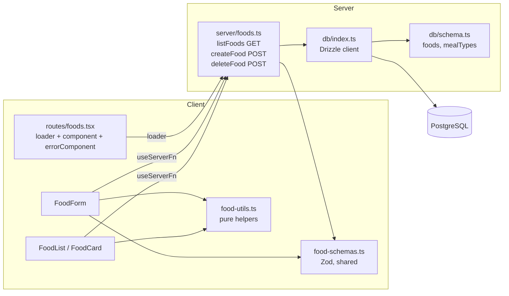
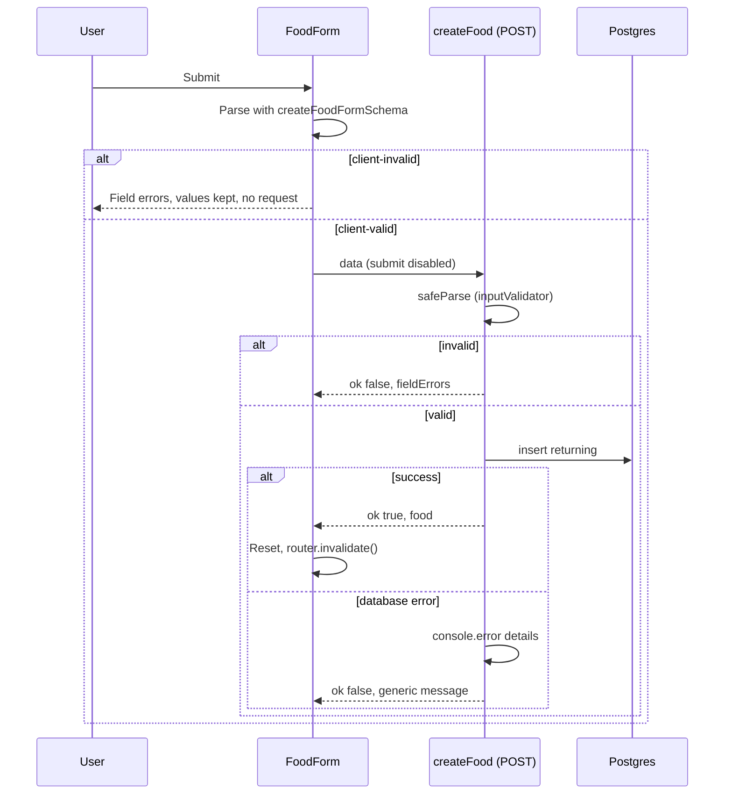
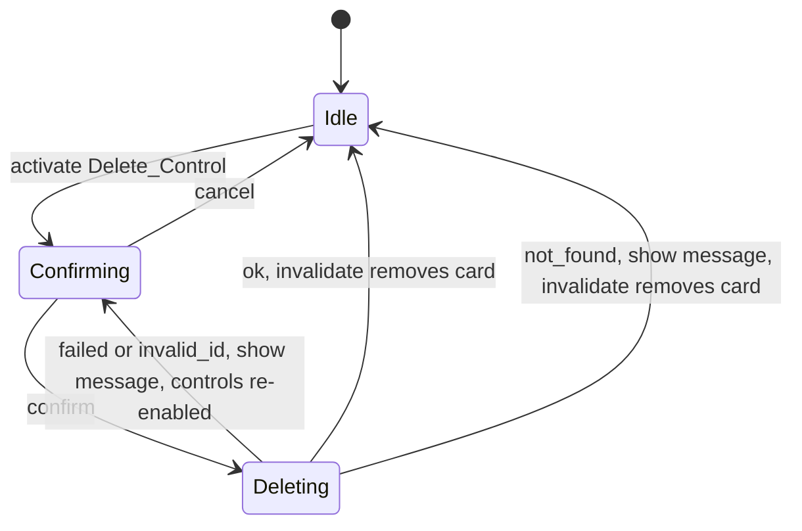

# Design Document

## Overview

This feature adds the `/foods` route to Foodstarter. One page holds a form for adding a food entry, a list of every saved entry, and a delete flow with confirmation. Data lives in the `foods` table in `src/db/schema.ts`. This feature extends that table with four optional columns: `protein_g`, `carbs_g`, `fat_g` (integer grams, 0 to 10000) and `serving_size` (`varchar(100)`). The schema change ships as a Drizzle migration created with `drizzle-kit generate` and applied with `drizzle-kit migrate`. `drizzle-kit push` is not used. The form collects the new values and each food card shows the ones that are present. Edit is out of scope.

The design follows the project rules:

- The route loader calls a GET server function to read entries. The form and the list call POST server functions through `useServerFn`.
- Components and routes never touch the database. Only files in `src/server/` import the Drizzle client.
- One Zod schema file is shared by the server functions and the form, so client and server enforce the same rules.
- Types come from `$inferSelect` and `$inferInsert`. Meal types come only from `mealTypes` in `src/db/schema.ts`.

### Research Findings

| Finding | Source | Design impact |
| --- | --- | --- |
| Installed `@tanstack/react-start` is 1.169.7 and `@tanstack/react-router` is 1.170.46. `createServerFn` exposes `inputValidator`, not `validator`. | `package.json`, `node_modules/@tanstack/start-client-core/.../createServerFn.d.ts` | Use `@tanstack/react-start` imports and `.inputValidator(...)`. |
| `inputValidator` accepts any function `(data: unknown) => T`, and the handler receives its return value. | Same type definitions | The validator function returns Zod's `safeParse` result. The handler returns field errors instead of throwing, which satisfies "return an error identifying each invalid field". |
| Zod is v4 (`^4.1.12`). `z.uuid()`, `z.enum(readonlyTuple)`, `z.flattenError()` and `.trim()` exist. | `package.json`, Zod 4 API | Use `z.enum(mealTypes)`, `z.uuid()` and `z.flattenError(error).fieldErrors`. |
| Drizzle is `drizzle-orm ^0.45.4` with `postgres` (postgres-js) installed. `seed.ts` already uses `drizzle-orm/postgres-js`. | `package.json`, `src/db/seed.ts` | Add `src/db/index.ts` with the same driver. Use `.returning()` for insert and delete. |
| `src/db/schema.ts` defines `foods`, `mealTypes`, `Food`, `NewFood`, `MealType`. `eatenAt` defaults to `now()`. It does not yet contain `protein_g`, `carbs_g`, `fat_g` or `serving_size`. | `src/db/schema.ts` | The design adds four nullable columns to this file. Omitting `eatenAt` on insert uses the database default. `Food` and `NewFood` pick up the new fields through `$inferSelect` and `$inferInsert`, so no hand-written type changes are needed. |
| `drizzle/migrations/` holds `0000_loose_black_widow.sql` and a `meta/` journal. `drizzle.config.ts` sets this folder as `out`. | Workspace listing | `drizzle-kit generate` writes `0001_*.sql` and updates `meta/`. The migration is committed with the schema change. |
| A nullable column added without a default is a metadata-only change in PostgreSQL. Existing rows read as NULL. | PostgreSQL `ALTER TABLE ... ADD COLUMN` behavior | The migration needs no backfill and no table rewrite. Existing rows satisfy Requirement 7.12 by construction. |
| In Zod 4, `z.number("message")` sets the type-error message, `z.number()` rejects `NaN` and infinities, and checks such as `.trim()` run in the order they are chained. | Zod 4 API | `.trim().max(100, ...)` measures the trimmed length. Macro bounds use one shared message on every check. |
| `#/*` maps to `./src/*` in both `package.json` `imports` and `tsconfig.json` paths. | `package.json`, `tsconfig.json` | Import with `#/...`. |
| Tailwind v4 renames gradient utilities to `bg-linear-to-*`. | Tailwind v4 docs | Use `bg-linear-to-br`. |
| `src/routes/` has only `__root.tsx` and `index.tsx`. `src/db/index.ts`, `src/server/`, `src/components/` and `src/lib/` do not exist yet. | Workspace listing | This design creates them. |

### Design Decisions

1. **Validation returns results instead of throwing.** Requirements 3.13 and 4.11 say the server function returns an error naming each invalid field. A throwing validator would surface as an opaque error on the client. The validator function runs `safeParse` and the handler branches on `success`, before any database call.
2. **One schema file for server and client.** `src/server/food-schemas.ts` has no database import, so the form can import it without pulling the Drizzle client into the client bundle. The form validates before submitting using the same schema.
3. **Mutation results are a discriminated union.** Create and delete return `{ ok: true, ... }` or `{ ok: false, code, message }`. Expected failures (validation, not found, database failure) are values the UI can display. List throws, because the route `errorComponent` displays that failure (Requirement 5.11).
4. **Refresh by `router.invalidate()`.** After a successful create or delete, the component calls `router.invalidate()`, which re-runs the loader. This keeps one source of truth and meets the 2-second requirement for the table sizes in scope. Optimistic updates are not used.
5. **Requirement 1.4 and 5.11 reconciliation.** Requirement 1.4 wants the heading and form to remain when the list fails. Requirement 5.11 wants the route error component to show the error. The route `errorComponent` renders the heading, a working form and an error panel with a retry button. The form still calls `router.invalidate()`, so a successful save re-runs the loader and clears the error if the list recovers.
6. **Pure helpers in `src/lib/food-utils.ts`.** Formatting and visibility rules are pure functions, which keeps them property-testable.
7. **Eaten-at default on the client after mount.** Rendering "now" during server rendering would differ from the client by up to a minute and cause a hydration mismatch. The field starts empty and an effect sets it after mount.
8. **Server time for a missing eaten-at.** The create function omits `eatenAt` from the insert, so Postgres `now()` applies. App and database run on the same host in development.
9. **New columns are nullable with no default.** NULL means "not provided", which is different from a recorded 0. A default of 0 would make existing rows look like they recorded zero grams. Requirements 3.7, 3.10 and 5.7 depend on this distinction.
10. **No database CHECK constraints for the new ranges.** Requirement 7.10 specifies plain nullable `integer` and `varchar(100)` columns. The 0 to 10000 range is enforced by the shared Zod schema at the server function boundary, matching how `calories` is handled. The `varchar(100)` length is enforced by the database as well.
11. **Mapping from validated input to insert values is a pure function.** `toFoodValues` in `src/lib/food-utils.ts` turns validated input into a `NewFood`. It holds the NULL rules (omitted macro to NULL, 0 stays 0, blank serving size to NULL, notes blank to NULL), so these rules are property-testable without a database.
12. **Macro inputs are text inputs with numeric keyboard hints.** A `type="number"` input reports the value `""` for non-numeric text, which would make "abc" look like an empty (valid) field and defeat Requirement 2.12. The macro fields use `type="text"` with `inputMode="numeric"`. A strict parser turns the text into a number, or `NaN` for text that is not a plain number, and the schema rejects it.
13. **Serving size has no `maxLength` attribute.** Requirement 2.13 requires the error "Serving size must be 100 characters or fewer". A `maxLength` of 100 would stop users from typing past the limit, so the message could never appear. The limit applies after trimming, so padded input that trims to 100 characters or fewer stays valid.
14. **Display rules are pure helpers.** `getVisibleMacros` and `getVisibleServingSize` decide what `FoodCard` shows. The card renders exactly what they return, which keeps "omit absent values, no placeholders" testable as a property.

## Architecture



### Create flow



### Delete flow



## Components and Interfaces

### New and changed files

| Path | Purpose |
| --- | --- |
| `src/db/schema.ts` (changed) | Adds `proteinG`, `carbsG`, `fatG` and `servingSize` to `foods`. |
| `drizzle/migrations/0001_*.sql` and `meta/` (generated) | Food_Migration created by `drizzle-kit generate`. Not hand-edited. |
| `src/db/index.ts` | Drizzle client (server only). Reads `DATABASE_URL`, throws if missing. |
| `src/server/food-schemas.ts` | Zod schemas and result types. No database import. |
| `src/server/foods.ts` | `listFoods`, `createFood`, `deleteFood` server functions. |
| `src/lib/food-utils.ts` | Pure helpers: `formatKcal`, `hasVisibleNotes`, `getVisibleMacros`, `getVisibleServingSize`, `toOptionalWholeNumber`, `toFoodValues`, `toLocalDateTimeValue`, `fromLocalDateTimeValue`, `deleteLabel`, `mealBadgeClass`. |
| `src/components/food-form.tsx` | `FoodForm`. |
| `src/components/food-list.tsx` | `FoodList` with the total, empty state and delete flow. |
| `src/components/food-card.tsx` | `FoodCard` for one entry. |
| `src/components/meal-badge.tsx` | `MealBadge`. |
| `src/routes/foods.tsx` | Route `/foods`: loader, page, `errorComponent`. |

`src/routeTree.gen.ts` is regenerated by the router plugin and is not edited.

### `src/db/schema.ts` (change)

Add four nullable columns to `foods`. No `.notNull()` and no `.default(...)`. The rest of the file is unchanged.

```ts
export const foods = pgTable(
	"foods",
	{
		id: uuid("id").primaryKey().defaultRandom(),
		name: varchar("name", { length: 255 }).notNull(),
		mealType: mealTypeEnum("meal_type").notNull(),
		calories: integer("calories").notNull(),
		proteinG: integer("protein_g"),
		carbsG: integer("carbs_g"),
		fatG: integer("fat_g"),
		servingSize: varchar("serving_size", { length: 100 }),
		notes: text("notes"),
		eatenAt: timestamp("eaten_at", { withTimezone: true })
			.defaultNow()
			.notNull(),
		// createdAt and updatedAt unchanged
	},
	(table) => [index("foods_eaten_at_idx").on(table.eatenAt)],
);
```

`Food` then has `proteinG: number | null`, `carbsG: number | null`, `fatG: number | null` and `servingSize: string | null`. `NewFood` has the same four fields as optional.

### Migration approach

1. Edit `src/db/schema.ts` as above.
2. Run `pnpm drizzle-kit generate`. It writes `drizzle/migrations/0001_<name>.sql` and updates `meta/_journal.json` and the snapshot.
3. Review the generated SQL. It should contain only four additive statements:

```sql
ALTER TABLE "foods" ADD COLUMN "protein_g" integer;
ALTER TABLE "foods" ADD COLUMN "carbs_g" integer;
ALTER TABLE "foods" ADD COLUMN "fat_g" integer;
ALTER TABLE "foods" ADD COLUMN "serving_size" varchar(100);
```

4. Run `pnpm drizzle-kit migrate` against the local database. `drizzle-kit push` is not used for this change.
5. Commit the schema change, the generated SQL and the `meta/` files together.

Existing-row handling: the columns are nullable with no default, so every row that exists before the migration keeps all its data and reads NULL for the four new columns. No backfill statement is needed. If the generated SQL contains anything other than these four `ADD COLUMN` statements (for example a `DROP` or a `NOT NULL`), the schema edit is wrong and must be fixed before running `migrate`.

### `src/db/index.ts`

```ts
import { drizzle } from "drizzle-orm/postgres-js";
import postgres from "postgres";
import * as schema from "./schema";

const databaseUrl = process.env.DATABASE_URL;
if (!databaseUrl) {
	throw new Error("DATABASE_URL is not set. Define it in .env.local.");
}

export const db = drizzle(postgres(databaseUrl), { schema });
```

### `src/server/food-schemas.ts`

```ts
import { z } from "zod";
import { type Food, mealTypes } from "#/db/schema";

const eatenAtValue = z
	.string()
	.refine((v) => !Number.isNaN(Date.parse(v)), "Enter a valid date and time");

const macroMessage = "Enter a whole number from 0 to 10,000";

// Optional whole grams. Omitted (undefined) is valid and means "not provided".
// 0 is valid and is a recorded value.
const macroGrams = z
	.number(macroMessage)
	.int(macroMessage)
	.min(0, macroMessage)
	.max(10000, macroMessage)
	.optional();

export const createFoodSchema = z.object({
	name: z.string().trim().min(1, "Name is required").max(255, "Name must be 255 characters or fewer"),
	mealType: z.enum(mealTypes, "Choose a meal type"),
	calories: z
		.number("Calories must be a number")
		.int("Calories must be a whole number")
		.min(0, "Calories cannot be negative")
		.max(100000, "Calories must be 100,000 or fewer"),
	proteinG: macroGrams,
	carbsG: macroGrams,
	fatG: macroGrams,
	// Trimmed first, then the length check applies to the trimmed value.
	// Blank values pass here and are stored as NULL by toFoodValues.
	servingSize: z
		.string()
		.trim()
		.max(100, "Serving size must be 100 characters or fewer")
		.optional(),
	notes: z.string().max(1000, "Notes must be 1,000 characters or fewer").optional(),
	// Omitted or "" means "use the server time".
	eatenAt: z.union([z.literal(""), eatenAtValue]).optional(),
});

// Form variant: eaten-at is required in the UI (Requirement 2.4).
export const createFoodFormSchema = createFoodSchema.extend({
	eatenAt: eatenAtValue.min(1, "Eaten at is required"),
});

export const deleteFoodSchema = z.object({
	id: z.uuid("Invalid food identifier"),
});

export type CreateFoodInput = z.infer<typeof createFoodSchema>;
export type FieldErrors = Partial<Record<keyof CreateFoodInput, string[]>>;

export type CreateFoodResult =
	| { ok: true; food: Food }
	| { ok: false; code: "validation"; message: string; fieldErrors: FieldErrors }
	| { ok: false; code: "failed"; message: string };

export type DeleteFoodResult =
	| { ok: true; id: string }
	| { ok: false; code: "invalid_id" | "not_found" | "failed"; message: string };
```

`Food` is the type from `#/db/schema` (`typeof foods.$inferSelect`). The meal type list is not repeated anywhere.

Rules for the new fields:

- `proteinG`, `carbsG` and `fatG` are optional numbers. Decimals, negatives, values above 10000, `NaN` and non-numbers fail with "Enter a whole number from 0 to 10,000". `0` passes. `undefined` passes.
- Empty form text never reaches the schema as `""`. The form converts empty macro text to `undefined` (see `toOptionalWholeNumber`). A request that sends `""` or `null` for a macro is rejected with the same message, because only a number or an omitted key is valid.
- `servingSize` is trimmed by the schema. A string of 100 or fewer characters after trimming passes, including `""` and whitespace-only input. A longer one fails with "Serving size must be 100 characters or fewer". The parsed value is the trimmed string.
- `createFoodFormSchema` extends `createFoodSchema`, so it inherits the new fields and messages. The form and the server show the same text.

### `src/server/foods.ts`

```ts
import { createServerFn } from "@tanstack/react-start";
import { desc, eq } from "drizzle-orm";
import { z } from "zod";
import { db } from "#/db";
import { foods } from "#/db/schema";
import { toFoodValues } from "#/lib/food-utils";
import {
	type CreateFoodResult,
	createFoodSchema,
	type DeleteFoodResult,
	deleteFoodSchema,
} from "./food-schemas";

export const listFoods = createServerFn({ method: "GET" }).handler(async () => {
	try {
		return await db.select().from(foods).orderBy(desc(foods.eatenAt), desc(foods.createdAt));
	} catch (error) {
		console.error("listFoods failed:", error);
		throw new Error("Could not load foods. Please try again.");
	}
});

export const createFood = createServerFn({ method: "POST" })
	.inputValidator((data: unknown) => createFoodSchema.safeParse(data))
	.handler(async ({ data }): Promise<CreateFoodResult> => {
		if (!data.success) {
			return {
				ok: false,
				code: "validation",
				message: "Some fields are invalid.",
				fieldErrors: z.flattenError(data.error).fieldErrors,
			};
		}
		const values = toFoodValues(data.data);
		try {
			const [food] = await db.insert(foods).values(values).returning();
			return { ok: true, food };
		} catch (error) {
			console.error("createFood failed:", error);
			return { ok: false, code: "failed", message: "Could not save the food. Please try again." };
		}
	});

export const deleteFood = createServerFn({ method: "POST" })
	.inputValidator((data: unknown) => deleteFoodSchema.safeParse(data))
	.handler(async ({ data }): Promise<DeleteFoodResult> => {
		if (!data.success) {
			return { ok: false, code: "invalid_id", message: "The food identifier is invalid." };
		}
		try {
			const [deleted] = await db.delete(foods).where(eq(foods.id, data.data.id)).returning({ id: foods.id });
			if (!deleted) {
				return { ok: false, code: "not_found", message: "This food no longer exists." };
			}
			return { ok: true, id: deleted.id };
		} catch (error) {
			console.error("deleteFood failed:", error);
			return { ok: false, code: "failed", message: "Could not delete the food. Please try again." };
		}
	});
```

Notes:

- A missing `eatenAt` produces no `eatenAt` key, so the column default `now()` applies.
- `toFoodValues` builds the insert value. It runs after validation, so no database call happens for invalid input.
- An omitted macro is stored as `NULL`, not 0. A macro of 0 is stored as 0.
- A serving size that is omitted, empty or whitespace-only is stored as `NULL`. Any other value is stored trimmed.
- Empty or whitespace-only notes are stored as `NULL`, which matches the list rule that hides empty notes.
- `.returning()` returns the full row, so the result includes the stored macros and serving size (Requirement 4.3). Values left empty come back as `null` (Requirement 4.5).
- `Food` has `Date` fields. TanStack Start serializes `Date` values across the server function boundary, so the list receives real `Date` objects.
- Server-only error details go to `console.error`. Messages returned to the client are fixed strings.

### `src/lib/food-utils.ts`

```ts
import type { Food, MealType, NewFood } from "#/db/schema";
import type { CreateFoodInput } from "#/server/food-schemas"; // type-only, no runtime import

export type MacroDisplay = {
	label: "Protein" | "Carbs" | "Fat";
	value: string; // for example "12 g"
};

export function formatKcal(calories: number): string;                // 320 -> "320 kcal"
export function hasVisibleNotes(notes: string | null): notes is string; // false for null, "", whitespace

// Display rules (Requirements 5.5 to 5.8)
// Returns entries in the fixed order Protein, Carbs, Fat. Skips null values.
// Keeps 0: proteinG 0 -> { label: "Protein", value: "0 g" }.
export function getVisibleMacros(
	food: Pick<Food, "proteinG" | "carbsG" | "fatG">,
): MacroDisplay[];
// Returns the trimmed text, or null when the value is null or blank.
export function getVisibleServingSize(servingSize: string | null): string | null;

// Form and insert mapping (Requirements 2.9 to 2.12, 3.7, 3.9, 3.10, 4.4, 4.5)
// "" or whitespace -> undefined. Plain decimal text such as "12", "-3", "1.5" -> that number.
// Anything else ("abc", "1e3", "0x10", "12g") -> NaN, which the schema rejects.
export function toOptionalWholeNumber(text: string): number | undefined;
// Validated input -> insert value. Omitted macro -> null, 0 -> 0, serving size trimmed,
// blank serving size -> null, blank notes -> null, eatenAt omitted when missing.
export function toFoodValues(input: CreateFoodInput): NewFood;

export function toLocalDateTimeValue(date: Date): string;            // "YYYY-MM-DDTHH:mm" in local time
export function fromLocalDateTimeValue(value: string): Date;         // inverse, local time
export function deleteLabel(name: string): string;                   // `Delete ${name}`
export const mealBadgeClass: Record<MealType, string>;               // typed by mealTypes
```

`mealBadgeClass` is `Record<MealType, string>`. TypeScript then fails to compile if a value is added to `mealTypes` without a badge style.

| Meal type | Badge classes (text on background) |
| --- | --- |
| breakfast | `bg-amber-100 text-amber-900` |
| lunch | `bg-emerald-100 text-emerald-900` |
| dinner | `bg-indigo-100 text-indigo-900` |
| snack | `bg-rose-100 text-rose-900` |

All pairs are shade 100 against shade 900, which exceeds 4.5:1.

### `src/routes/foods.tsx`

```tsx
export const Route = createFileRoute("/foods")({
	loader: () => listFoods(),
	component: FoodsPage,
	errorComponent: FoodsError,
});
```

- `FoodsPage` reads `Route.useLoaderData()` and renders `PageShell` with `<FoodForm />` and `<FoodList foods={foods} />`.
- `FoodsError` renders `PageShell` with `<FoodForm />` and an error panel in the list position (`role="alert"`, text "The foods could not be loaded.", and a "Try again" button that calls `router.invalidate()`). It does not render a partial list.
- `PageShell` is a local component with the gradient background (`min-h-screen bg-linear-to-br from-indigo-700 via-purple-700 to-fuchsia-700`), the single `h1` "Add Food" in white, and the layout grid `grid grid-cols-1 gap-6 md:grid-cols-2`. The form comes first in the DOM, so it is first in the single column. Grid children use `min-w-0` so long names cannot widen the page.

### `FoodForm`

- Props: none. It calls `useServerFn(createFood)` and `useRouter()`.
- State: `values` (all strings: calories, `proteinG`, `carbsG`, `fatG` and `servingSize` are kept as text), `errors` (per field), `formError`, `pending`. The initial value of the four new fields is `""`, so they start empty (Requirement 2.9).
- On mount, an effect sets `eatenAt` to `toLocalDateTimeValue(new Date())`.
- On submit:
  1. Build the candidate: `calories` is `undefined` when the text is empty, otherwise `Number(text)`. `proteinG`, `carbsG` and `fatG` use `toOptionalWholeNumber(text)`, so empty or whitespace text becomes `undefined` (key omitted, stored as NULL), `"0"` becomes `0`, and text such as `"abc"` or `"1.5"` becomes a number the schema rejects. `servingSize` is sent as typed, and the schema trims it. `eatenAt` is converted with `fromLocalDateTimeValue(...).toISOString()` when present.
  2. Run `createFoodFormSchema.safeParse`. On failure, set per-field errors from `z.flattenError`, keep all values, and stop.
  3. Set `pending`, call `createFoodFn({ data })`.
  4. If `ok`, reset to initial values (fresh eaten-at) and call `router.invalidate()`.
  5. If `code: "validation"`, show `fieldErrors` next to fields and keep values.
  6. If `code: "failed"`, or the call throws, show a form-level `role="alert"` message and keep values.
  7. Clear `pending` in `finally`. The submit button is `disabled={pending}`.
- The meal type control is a `<select>` whose options are `mealTypes.map(...)`. There is no free-text path.
- Inputs: `name` (`maxLength` 255), `calories` (`type="number"`, `min=0`, `max=100000`, `step=1`), `datetime-local` for eaten-at, `textarea` for notes (`maxLength` 1000). Required fields use `required` and `aria-required`. Each error is linked with `aria-describedby`.
- New optional inputs, placed after calories and before notes:
  - "Protein (g)", "Carbs (g)" and "Fat (g)": `type="text"`, `inputMode="numeric"`, not `required`, empty by default. Each shows "Enter a whole number from 0 to 10,000" next to the field when invalid. Placeholder text is not used as the label.
  - "Serving size": `type="text"`, not `required`, empty by default, no `maxLength` attribute (see Design Decision 13). It shows "Serving size must be 100 characters or fewer" when the trimmed value is too long.
  - The three macro fields share one row at 768px and above (`grid grid-cols-3 gap-3`) and stack on narrow screens (`grid-cols-1 sm:grid-cols-3`), with `min-w-0` on each.
- Server-returned `fieldErrors` for the new keys render in the same places as client errors. Because the server and the form share one schema, the messages are identical.
- A successful save resets the four new fields to `""` along with the rest (Requirement 4.7). A failed save keeps what the user typed in them (Requirement 4.10).
- Card style: `rounded-xl bg-white p-6 text-slate-900 shadow-lg`.

### `FoodList` and `FoodCard`

- `FoodList` props: `foods: Food[]`. It shows "N foods" (`foods.length`), the empty-state message "No foods yet. Add your first food using the form." when `foods.length === 0`, and otherwise a `<ul>` of `FoodCard`s.
- State in `FoodList`: `confirmingId: string | null`, `pendingId: string | null`, `message: string | null`. It calls `useServerFn(deleteFood)` and `useRouter()`.
- `FoodCard` shows name (`break-words`, `wrap-anywhere`), `MealBadge`, `formatKcal(calories)`, eaten-at with `toLocaleString()` in the browser's time zone, and the notes line only when `hasVisibleNotes(notes)`.
- Macro and serving size display in `FoodCard`, between the calories line and the notes line:
  - `const macros = getVisibleMacros(food)` and `const serving = getVisibleServingSize(food.servingSize)`.
  - Each item in `macros` renders as a label and value, for example `Protein 12 g`, `Carbs 0 g`, `Fat 5 g`. The label is the text "Protein", "Carbs" or "Fat". The value is the whole number followed by `g`. A stored 0 is shown as `0 g`.
  - When `serving` is not `null`, the card renders `Serving` followed by the text. The text uses `break-words wrap-anywhere`, so a 100-character value without spaces stays inside the card.
  - A macro or the serving size that is NULL renders nothing: no label, no value, and no placeholder such as `0`, `-` or `N/A`.
  - The wrapper element for the macros renders only when `macros.length > 0`. The serving line renders only when `serving !== null`. A row created before the migration has four NULLs, so it renders exactly as before this change.
  - Macro text uses the same dark-on-white styling as the other card text (contrast of at least 4.5:1).
- Each card has one Delete button: `aria-label={deleteLabel(food.name)}`. Activating it sets `confirmingId`. The card then shows "Delete {name}?" with Confirm and Cancel buttons. Cancel clears `confirmingId` and makes no call.
- Confirm sets `pendingId`, disables the Delete button and Confirm, and calls `deleteFoodFn({ data: { id } })`:
  - `ok`: clear state, `router.invalidate()`.
  - `not_found`: show the message, `router.invalidate()`. The reload drops the stale card.
  - `invalid_id` or `failed`: show the message, keep the card, re-enable controls.
  - A thrown error is handled like `failed`.
- Card style: `rounded-xl bg-white/95 p-4 text-slate-900 shadow`.

Text on the gradient (heading, total) is white on indigo-700 and darker stops, above 4.5:1. All body, label and badge text sits on white or shade-100 backgrounds.

## Data Models

The `foods` table gains four nullable columns through the Food_Migration (see Migration approach). The table after the change:

| Column | Type | Notes |
| --- | --- | --- |
| `id` | `uuid` primary key | `defaultRandom()` |
| `name` | `varchar(255)` not null | |
| `meal_type` | `meal_type` enum not null | `breakfast`, `lunch`, `dinner`, `snack` |
| `calories` | `integer` not null | |
| `protein_g` | `integer` nullable | **New.** Whole grams, 0 to 10000 enforced by Zod. NULL means not provided. |
| `carbs_g` | `integer` nullable | **New.** Same rules as `protein_g`. |
| `fat_g` | `integer` nullable | **New.** Same rules as `protein_g`. |
| `serving_size` | `varchar(100)` nullable | **New.** Stored trimmed. NULL when blank. |
| `notes` | `text` nullable | |
| `eaten_at` | `timestamptz` not null | default `now()`, indexed (`foods_eaten_at_idx`) |
| `created_at` | `timestamptz` not null | default `now()` |
| `updated_at` | `timestamptz` not null | default `now()`, `$onUpdate` |

Types:

- `Food = typeof foods.$inferSelect` (existing export, used for list and create results). It now includes `proteinG`, `carbsG`, `fatG` (`number | null`) and `servingSize` (`string | null`).
- `NewFood = typeof foods.$inferInsert` (existing export, used as the return type of `toFoodValues`). The four new fields are optional.
- `CreateFoodInput = z.infer<typeof createFoodSchema>` is the wire input. It is a separate type because it has `eatenAt` as an ISO string and no generated columns.

The index on `eaten_at` supports the list order. The `ORDER BY eaten_at DESC, created_at DESC` query for up to 1,000 rows is well inside the 2-second budget.

Wire format of create input:

| Field | Wire type | Rule |
| --- | --- | --- |
| `name` | string | trimmed length 1 to 255 |
| `mealType` | string | one of `mealTypes` |
| `calories` | number | integer 0 to 100000 |
| `proteinG`, `carbsG`, `fatG` | number, optional | integer 0 to 10000. Key omitted when the field is empty. |
| `servingSize` | string, optional | trimmed length 0 to 100 |
| `notes` | string, optional | length 0 to 1000 |
| `eatenAt` | string, optional | `""` or parseable date and time string |

Mapping from wire input to stored value (`toFoodValues`):

| Input | Stored |
| --- | --- |
| macro omitted | `NULL` |
| macro `0` | `0` |
| macro `n` (1 to 10000) | `n` |
| `servingSize` omitted, `""` or whitespace only | `NULL` |
| `servingSize` `"  1 cup "` | `"1 cup"` |

Existing rows created before the migration read `proteinG`, `carbsG`, `fatG` and `servingSize` as `null`. The card shows nothing for them.

## Correctness Properties

*A property is a characteristic or behavior that should hold true across all valid executions of a system-essentially, a formal statement about what the system should do. Properties serve as the bridge between human-readable specifications and machine-verifiable correctness guarantees.*

Tests in this section cover the pure layer: the Zod schemas and the helpers in `src/lib/food-utils.ts`. Database reads and writes, UI behavior and styling are covered by integration and example tests (see Testing Strategy). Requirements 2.6, 2.7, 2.8, 2.10 and 2.11 repeat the rules of 3.1, 3.2, 3.4, 3.6 and 3.8. The form and server share one schema, so one property covers each pair.

### Property 1: Name validation and trimming

*For any* string `s`, `createFoodSchema` accepts it as `name` if and only if the length of `s` after trimming leading and trailing whitespace is between 1 and 255. When it accepts, the parsed `name` equals the trimmed string.

**Validates: Requirements 2.6, 3.1**

### Property 2: Calories validation

*For any* value `v` (integers, decimals, negatives, `NaN`, strings, `null`, `undefined`), `createFoodSchema` accepts it as `calories` if and only if `v` is a number that is an integer between 0 and 100000 inclusive.

**Validates: Requirements 2.7, 3.2**

### Property 3: Meal type validation

*For any* string `s`, `createFoodSchema` accepts it as `mealType` if and only if `s` is exactly one of the values in `mealTypes` (case-sensitive). This includes case variants of valid values and the empty string, which are rejected.

**Validates: Requirements 3.3**

### Property 4: Notes validation

*For any* string `s`, `createFoodSchema` accepts it as `notes` if and only if its length is at most 1000. An omitted `notes` value is also accepted.

**Validates: Requirements 2.8, 3.4**

### Property 5: Eaten-at validation

*For any* string `s`, `createFoodSchema` accepts it as `eatenAt` if and only if `s` is empty or `Date.parse(s)` is not `NaN`. An omitted `eatenAt` is also accepted.

**Validates: Requirements 3.5**

### Property 6: Macro validation

*For any* value `v` (integers, decimals, negatives, `NaN`, strings, `null`, `undefined`) and *for any* of the fields `proteinG`, `carbsG` and `fatG`, `createFoodSchema` accepts `v` for that field if and only if `v` is `undefined` or a number that is an integer from 0 to 10000 inclusive. This includes 0, which is accepted, and 10001, which is rejected. When it rejects, the field's error message is exactly "Enter a whole number from 0 to 10,000".

**Validates: Requirements 2.10, 2.12, 3.6, 3.7, 3.10**

### Property 7: Serving size validation and trimming

*For any* string `s`, `createFoodSchema` accepts it as `servingSize` if and only if the length of `s` after trimming leading and trailing whitespace is at most 100. When it accepts, the parsed `servingSize` equals the trimmed string, and a string of only whitespace parses to the empty string. An omitted `servingSize` is also accepted. When it rejects, the error message is exactly "Serving size must be 100 characters or fewer".

**Validates: Requirements 2.11, 2.13, 3.8, 3.9**

### Property 8: Invalid fields are reported exactly

*For any* otherwise valid input in which a chosen subset of fields (name, mealType, calories, proteinG, carbsG, fatG, servingSize, notes, eatenAt) is replaced with invalid values, `createFoodSchema.safeParse` fails and the keys of the flattened field errors equal that subset. When the subset is empty, parsing succeeds.

**Validates: Requirements 2.14, 3.13, 4.11**

### Property 9: Entry identifier validation

*For any* string `s`, `deleteFoodSchema` accepts `{ id: s }` if and only if `s` is a UUID. Generated UUIDs are accepted and arbitrary non-UUID strings are rejected.

**Validates: Requirements 8.4, 8.5**

### Property 10: Optional values map to NULL, zero and trimmed text

*For any* input that `createFoodSchema` accepts, `toFoodValues` returns a value in which each of `proteinG`, `carbsG` and `fatG` equals the input number when one was given (including 0) and is `null` when the input omitted it. `servingSize` is `null` when the input is omitted, empty or whitespace only, and otherwise equals the input with leading and trailing whitespace removed. `notes` is `null` when the input is omitted, empty or whitespace only. `eatenAt` is absent from the result when the input omitted it or sent an empty string.

**Validates: Requirements 3.7, 3.9, 3.10, 4.4, 4.5**

### Property 11: Whole-number text parsing

*For any* integer `n` in the range -100000 to 100000, `toOptionalWholeNumber(String(n))` returns `n`, also when the text is padded with whitespace. *For any* string made only of whitespace (including the empty string), it returns `undefined`. *For any* string that is not plain decimal text (letters, exponent or hex forms, trailing units), it returns `NaN`.

**Validates: Requirements 2.9, 2.12, 3.6, 3.7**

### Property 12: Calories display format

*For any* integer `n` from 0 to 100000, `formatKcal(n)` equals the decimal representation of `n` followed by a space and `kcal`, and parsing the leading integer from the result returns `n`.

**Validates: Requirements 5.3**

### Property 13: Notes line visibility

*For any* notes value, `hasVisibleNotes` returns `false` if the value is `null` or a string made only of whitespace (including the empty string), and returns `true` if the string contains at least one non-whitespace character.

**Validates: Requirements 5.4**

### Property 14: Macro display visibility

*For any* food whose `proteinG`, `carbsG` and `fatG` are each either `null` or an integer from 0 to 10000, `getVisibleMacros` returns exactly one entry for each non-`null` value and no entry for a `null` value. The entries appear in the order Protein, Carbs, Fat. Each entry has the label "Protein", "Carbs" or "Fat" for its source field, and a value equal to the decimal number followed by ` g` (so a stored 0 yields `0 g`). When all three values are `null`, the result is empty. No returned value is a placeholder such as `-`, `N/A` or an empty string.

**Validates: Requirements 5.5, 5.7, 5.8**

### Property 15: Serving size display visibility

*For any* `servingSize` value that is `null` or a string, `getVisibleServingSize` returns `null` when the value is `null` or contains only whitespace, and otherwise returns the trimmed text. When the stored value is already trimmed and non-empty, the returned text equals the stored text.

**Validates: Requirements 5.6, 5.7, 5.8**

### Property 16: Local date-time input round trip

*For any* `Date` `d` in a supported range, `fromLocalDateTimeValue(toLocalDateTimeValue(d))` equals `d` truncated to the minute, and `toLocalDateTimeValue(d)` matches `YYYY-MM-DDTHH:mm`.

**Validates: Requirements 2.3**

### Property 17: Delete label contains the entry name

*For any* non-empty food name `n`, `deleteLabel(n)` contains `n`.

**Validates: Requirements 8.17**

## Error Handling

| Situation | Where handled | Behavior |
| --- | --- | --- |
| Form input invalid (client) | `FoodForm` | Per-field messages from `createFoodFormSchema`, all values kept, no request sent. |
| Input invalid (server) | `createFood` | `{ ok: false, code: "validation", fieldErrors }`. No database call. The form shows the messages next to fields. |
| Insert fails | `createFood` | `console.error` with details. Returns the fixed message "Could not save the food. Please try again." The form shows it, keeps values, re-enables submit, list unchanged. |
| `listFoods` fails | `listFoods` and route `errorComponent` | `console.error` with details. Throws a fixed message. `FoodsError` shows heading, form and error panel with retry. No partial list. |
| Invalid id on delete | `deleteFood` | `{ ok: false, code: "invalid_id" }`, no write. The list shows the message and keeps the card. |
| Unknown id on delete | `deleteFood` | `{ ok: false, code: "not_found" }`, no change. The list shows the message and reloads, which removes the stale card. |
| Delete fails | `deleteFood` | `console.error`. Returns the fixed message. The list shows it, keeps the card and total, re-enables controls. |
| Network or transport error on a mutation | `FoodForm`, `FoodList` | The `catch` block treats it like `failed` and shows a fixed client-side message. |
| Double submit or double confirm | `FoodForm`, `FoodList` | The pending flag disables the controls. |
| Macro text is not a whole number from 0 to 10,000 | `FoodForm`, `createFood` | Message "Enter a whole number from 0 to 10,000" next to that field. Other values are kept and no request is sent from the form. |
| Serving size over 100 characters after trimming | `FoodForm`, `createFood` | Message "Serving size must be 100 characters or fewer" next to the field. |
| Migration not applied (new columns missing) | `listFoods`, `createFood` | The database rejects the query. The existing paths handle it: `listFoods` logs and throws the fixed message, `createFood` logs and returns the fixed failure message. Apply the migration with `drizzle-kit migrate`. |
| Missing `DATABASE_URL` | `src/db/index.ts` | Throws at server startup with a message that names the variable, not its value. |

Messages returned to the client never contain database errors, stack traces or SQL.

## Testing Strategy

### Why both unit and property tests

The pure layer (schemas and helpers) has wide input spaces, so property tests find boundary bugs that a few examples miss. The database, the UI and the styling are CRUD, rendering and layout. Those use example-based, integration and manual checks.

### Property-based tests

- Library: `fast-check`, run by `vitest` (already installed). Add `fast-check` as a dev dependency. Do not write a custom generator framework.
- Run each property with at least 100 iterations (`fc.assert(..., { numRuns: 100 })`).
- Implement each property from the Correctness Properties section as a single property test.
- Tag each test with a comment in this format: `Feature: add-food-route, Property {number}: {property_text}`.
- File: `src/lib/food-utils.test.ts` for Properties 10 to 17 and `src/server/food-schemas.test.ts` for Properties 1 to 9.
- Generator notes: use `fc.string()` mixed with `fc.stringMatching(/\s*/)` padding for names, `fc.oneof(fc.integer(), fc.double(), fc.string(), fc.constant(null))` for calories, `fc.uuid()` and `fc.string()` for ids, and `fc.date()` limited to a range that Postgres and `Date` both represent.
- Macro generators (Properties 6, 10, 14): `fc.oneof(fc.integer({ min: 0, max: 10000 }), fc.constantFrom(0, 10000, 10001, -1), fc.double(), fc.string(), fc.constant(null), fc.constant(undefined))` for validation, and `fc.option(fc.integer({ min: 0, max: 10000 }), { nil: null })` for display. Always include the boundaries 0, 10000, 10001 and -1.
- Serving size generators (Properties 7, 10, 15): `fc.string({ maxLength: 120 })` combined with `fc.stringMatching(/^\s*$/)` for whitespace-only values, and a padded string built from `fc.string({ maxLength: 100 })` with whitespace on both sides, so both the "trimmed length 100 passes" and "101 fails" boundaries are hit.
- Text parsing generators (Property 11): `fc.integer({ min: -100000, max: 100000 })` with optional whitespace padding, `fc.stringMatching(/^\s*$/)`, and strings that include letters, `e`, `0x` and unit suffixes.

### Unit and component tests (example-based)

Use `vitest` with `jsdom` and `@testing-library/react` (installed). Mock the server functions.

- Route: renders at `/foods` with one `h1` containing "Add Food", one form and one list (1.1 to 1.3). `errorComponent` shows heading, form and error message (1.4, 5.11).
- Form: fields present (including protein, carbs, fat and serving size), four meal options equal `mealTypes`, required markers on name, meal type, calories and eaten-at only, and the four new fields start empty and are not required (2.1, 2.2, 2.4, 2.9). Invalid submit shows messages, keeps values, makes no call (2.14, 3.11). Example messages: "abc" and "10001" in a macro field show "Enter a whole number from 0 to 10,000", and 101 characters of serving size shows "Serving size must be 100 characters or fewer" (2.12, 2.13). An empty macro field sends no key and a "0" macro field sends `0`. Success resets the form including the new fields and calls `router.invalidate()` (4.6, 4.7). Submit is disabled while pending (4.8). A failure keeps values, including the new fields, and re-enables submit (4.10).
- List and card: empty state with total 0, total equals rendered cards, notes line hidden for blank notes (5.4, 5.9, 5.10). A card with `proteinG: 12, carbsG: 0, fatG: null, servingSize: "1 cup"` shows "Protein 12 g", "Carbs 0 g" and "1 cup", and shows no "Fat" label and no `-` or `N/A` text. A card with all four new values `null` shows no Protein, Carbs, Fat or Serving text (5.5 to 5.8). A 100-character serving size with no spaces does not overflow the card (6.8). Delete flow: one Delete button per card, confirmation shows the name, cancel makes no call, confirm calls once, pending disables controls, success, not-found and failure branches (8.1 to 8.3, 8.8 to 8.10, 8.12, 8.14, 8.15).
- Server functions with a mocked `db`: invalid create input, including an invalid macro or an over-long serving size, makes no insert call (3.12, 3.13); a valid input with the four new fields calls `values` with the mapped `proteinG`, `carbsG`, `fatG` and `servingSize` (4.4, 4.5); a rejected insert returns the fixed message, calls `console.error`, and the message does not contain the mocked error text (4.9, 7.7, 8.13); an invalid delete id makes no delete call (8.5).
- `mealBadgeClass` has a unique class string for every entry of `mealTypes` (6.4).

### Integration tests (real PostgreSQL)

Run against a separate test database (`docker-compose.test.yml` with `tmpfs`, port 5433, `.env.test`) as described in `DOCKER-POSTGRES-BEST-PRACTICES.md`. Apply migrations before the run. Use 1 to 3 examples each, not property tests.

- Create inserts exactly one row, returns the generated id and stored `eatenAt`, and uses server time when `eatenAt` is omitted (4.1 to 4.3).
- Create with `proteinG: 0`, `carbsG: 25`, `fatG` omitted and `servingSize: "  150 g "` returns and stores `0`, `25`, `null` and `"150 g"`. Create with all four omitted returns and stores four `null` values (4.3 to 4.5).
- Migration on existing data: on a scratch database, apply `0000` only, insert a row, apply `0001` with `drizzle-kit migrate`, then check that the row is still present with its original values and that `protein_g`, `carbs_g`, `fat_g` and `serving_size` are all NULL. `listFoods` returns that row and the card shows no new content (5.8, 7.12). This uses the migration files, not `push`.
- List returns all rows, ordered by `eatenAt` descending then `createdAt` descending, including a tie case (5.1, 5.2).
- Delete removes exactly one row and leaves the others unchanged, returns the id, and a random unknown UUID returns `not_found` with the table unchanged (8.6, 8.7, 8.11).
- Deleting the same id twice returns `ok` then `not_found`, and the table after the second call equals the table after the first (8.16).

### Smoke and manual checks

- `pnpm check` reports zero errors and zero warnings (7.8). `tsc --noEmit` passes (7.5).
- Schema check: `src/db/schema.ts` defines `proteinG`, `carbsG` and `fatG` as nullable `integer` and `servingSize` as nullable `varchar(100)` with no default (7.10). The generated `0001_*.sql` contains only the four `ADD COLUMN` statements, and `git grep "drizzle-kit push"` finds no use of `push` in scripts or docs for this change (7.11).
- Type check: `Food["proteinG"]` is `number | null` and no hand-written type duplicates these fields (7.5).
- Review or grep: no `drizzle` or `#/db` import in `src/routes/` or `src/components/`, no literal meal type list outside `src/db/schema.ts`, and the HTTP methods are as specified (7.1 to 7.4, 7.6, 7.9).
- Browser check at 320px, 768px and 1920px: single column below 768px with the form first, two columns at 768px and above, no horizontal scroll with a 100-character name without spaces (6.6 to 6.8).
- Contrast check of body, label and badge text with the browser dev tools or a Lighthouse audit (6.5). Visual check of gradient, card radius and shadow (6.1 to 6.3).

### Dependencies to add

- `fast-check` (dev) for property tests.
- No new runtime dependency. `zod`, `drizzle-orm`, `postgres`, `@tanstack/react-start` and `tailwindcss` are installed.
